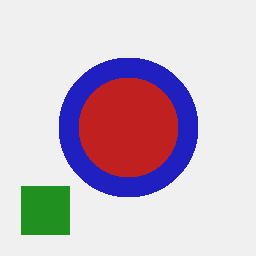
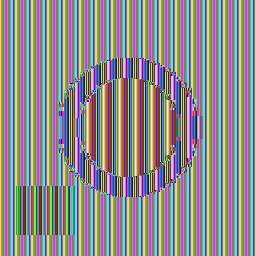
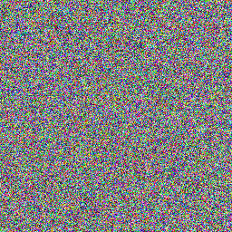
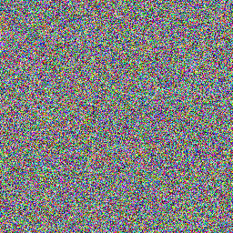
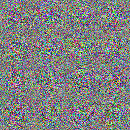
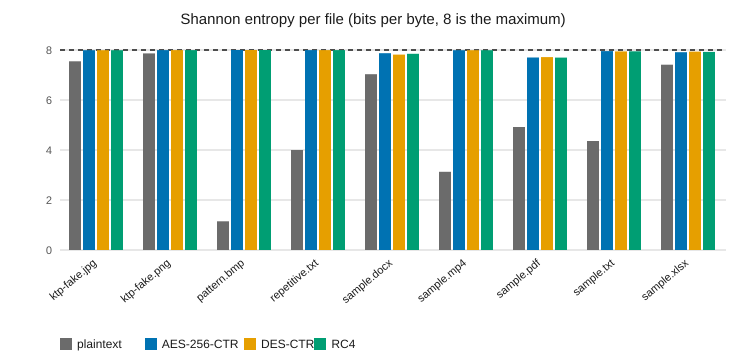
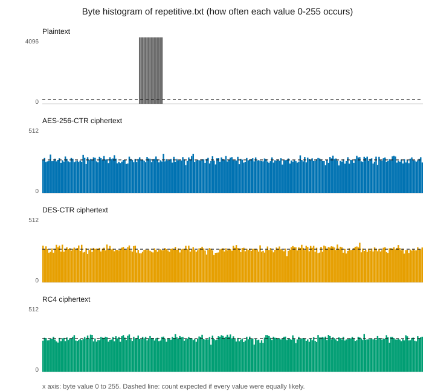
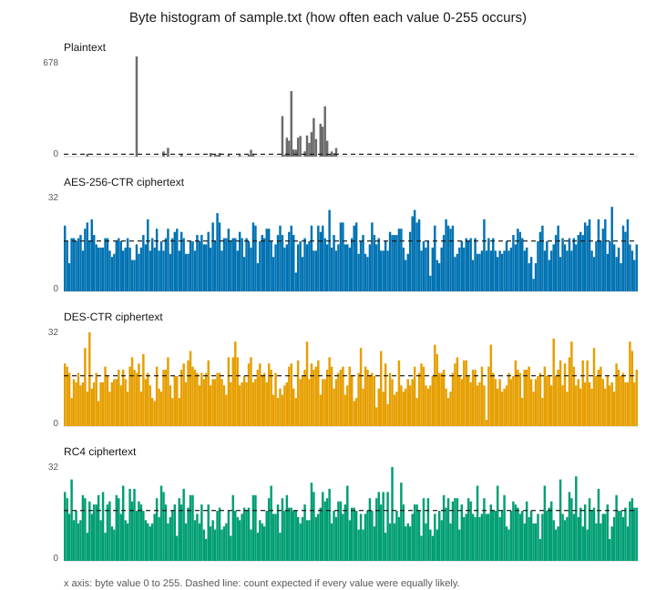

# Ciphertext analysis: AES-256-CTR vs DES-CTR vs RC4

Generated by `go run ./cmd/cipheranalysis`. Every sample is encrypted with the real `crypto.Envelope` (the same code the application uses), once per algorithm. Samples are the **fake** files in `scripts/testdata/`. Running-time results are in the benchmark report, not here.

## 1. Size, entropy and uniformity

| File | Alg | Plain B | Cipher B | Meta B | Entropy plain → cipher | Chi-square plain → cipher | Two encryptions differ |
|---|---|---:|---:|---:|---:|---:|---:|
| ktp-fake.jpg | AES-256-CTR | 24831 | 24831 | 168 | 7.5484 → 7.9915 | 35685 → 290.4 | 99.59% |
| ktp-fake.jpg | DES-CTR | 24831 | 24831 | 136 | 7.5484 → 7.9924 | 35685 → 261.1 | 99.63% |
| ktp-fake.jpg | RC4 | 24831 | 24831 | 152 | 7.5484 → 7.9929 | 35685 → 245.4 | 99.57% |
| ktp-fake.png | AES-256-CTR | 70874 | 70874 | 168 | 7.8659 → 7.9973 | 13998 → 270.8 | 99.64% |
| ktp-fake.png | DES-CTR | 70874 | 70874 | 136 | 7.8659 → 7.9973 | 13998 → 267.1 | 99.62% |
| ktp-fake.png | RC4 | 70874 | 70874 | 152 | 7.8659 → 7.9974 | 13998 → 257.1 | 99.64% |
| pattern.bmp | AES-256-CTR | 196662 | 196662 | 168 | 1.1472 → 7.9991 | 28499723 → 255.2 | 99.58% |
| pattern.bmp | DES-CTR | 196662 | 196662 | 136 | 1.1472 → 7.9990 | 28499723 → 264.1 | 99.63% |
| pattern.bmp | RC4 | 196662 | 196662 | 152 | 1.1472 → 7.9990 | 28499723 → 264.9 | 99.60% |
| repetitive.txt | AES-256-CTR | 65536 | 65536 | 168 | 4.0000 → 7.9968 | 983040 → 290.3 | 99.64% |
| repetitive.txt | DES-CTR | 65536 | 65536 | 136 | 4.0000 → 7.9968 | 983040 → 288.6 | 99.61% |
| repetitive.txt | RC4 | 65536 | 65536 | 152 | 4.0000 → 7.9975 | 983040 → 224.4 | 99.60% |
| sample.docx | AES-256-CTR | 1181 | 1181 | 168 | 7.0306 → 7.8707 | 7056 → 202.6 * | 99.66% |
| sample.docx | DES-CTR | 1181 | 1181 | 136 | 7.0306 → 7.8144 | 7056 → 278.9 * | 99.66% |
| sample.docx | RC4 | 1181 | 1181 | 152 | 7.0306 → 7.8475 | 7056 → 238.6 * | 99.75% |
| sample.mp4 | AES-256-CTR | 28024 | 28024 | 168 | 3.1295 → 7.9940 | 3598843 → 235.6 | 99.59% |
| sample.mp4 | DES-CTR | 28024 | 28024 | 136 | 3.1295 → 7.9927 | 3598843 → 284.6 | 99.64% |
| sample.mp4 | RC4 | 28024 | 28024 | 152 | 3.1295 → 7.9932 | 3598843 → 265.2 | 99.68% |
| sample.pdf | AES-256-CTR | 701 | 701 | 168 | 4.9218 → 7.6989 | 10393 → 270.0 * | 99.71% |
| sample.pdf | DES-CTR | 701 | 701 | 136 | 4.9218 → 7.7140 | 10393 → 240.1 * | 99.71% |
| sample.pdf | RC4 | 701 | 701 | 152 | 4.9218 → 7.6978 | 10393 → 262.7 * | 99.86% |
| sample.txt | AES-256-CTR | 4116 | 4116 | 168 | 4.3618 → 7.9571 | 68857 → 238.2 | 99.61% |
| sample.txt | DES-CTR | 4116 | 4116 | 136 | 4.3618 → 7.9460 | 68857 → 301.2 | 99.54% |
| sample.txt | RC4 | 4116 | 4116 | 152 | 4.3618 → 7.9490 | 68857 → 288.2 | 99.61% |
| sample.xlsx | AES-256-CTR | 2590 | 2590 | 168 | 7.4115 → 7.9116 | 8291 → 303.7 | 99.85% |
| sample.xlsx | DES-CTR | 2590 | 2590 | 136 | 7.4115 → 7.9355 | 8291 → 226.6 | 99.46% |
| sample.xlsx | RC4 | 2590 | 2590 | 152 | 7.4115 → 7.9232 | 8291 → 266.3 | 99.77% |

`*` = file shorter than 1280 bytes: fewer than 5 expected bytes per value, so chi-square is not meaningful (and entropy is capped at log2(length)).

How to read it:

- **Entropy** is bits of information per byte, 0 to 8. Text and documents are well below 8; good ciphertext is close to 8.
- **Chi-square** compares the byte counts with a perfectly even spread. For random data it is about 255; above about 293 would be suspicious (5% level).
- **Cipher B = Plain B** for all three: CTR and RC4 add no padding. The real overhead is **Meta B** (IV, two wrapped keys, HMAC tag), stored in MongoDB and identical for every file of the same algorithm.
- **Two encryptions differ**: the same file encrypted twice uses a fresh key and IV each time, so about 99.6% (255 out of 256) of byte positions differ, which is what unrelated random data gives by chance.

## 2. First 32 bytes

The start of a file usually names its type (`%PDF`, `PK` for DOCX/XLSX, the PNG/JPEG signature). After encryption it must be unrecognisable.

| File | Alg | First 32 bytes (hex) |
|---|---|---|
| ktp-fake.jpg | plaintext | `ffd8ffdb00840006040506050406060506070706080a100a0a09090a140e0f0c` |
| ktp-fake.jpg | AES-256-CTR | `3178233f5fec1c42c2555d6022efaec3eb204c7cc6b92d9444eaf3b4d95034d9` |
| ktp-fake.jpg | DES-CTR | `fbe331c92511a1bafb4b72104f63dce1a94a9c62058e9ec604a50c3e8d5e09fc` |
| ktp-fake.jpg | RC4 | `9330ea5dbc020366a9eb0d379ff7ed58ce2212b76e3bdd0091fe3e63967ebd1e` |
| ktp-fake.png | plaintext | `89504e470d0a1a0a0000000d4948445200000280000001900802000000b19146` |
| ktp-fake.png | AES-256-CTR | `8ca21f9224b23f5cc55d98d3f6382f74157e73d032fb352bed86ebdeb77656be` |
| ktp-fake.png | DES-CTR | `ba6c99c4c1019ac5fbb8b61a1c9117c62bacb9e1496bbd4356bcd3b3fcae180d` |
| ktp-fake.png | RC4 | `510143294667bd6756d91608fb87aae165fd939590ce280c8eff496927ec43af` |
| pattern.bmp | plaintext | `424d360003000000000036000000280000000001000000010000010018000000` |
| pattern.bmp | AES-256-CTR | `924fc771466864f45faa5f74c5759dcba186cfd5b8fd538f90efe2d650e2cb01` |
| pattern.bmp | DES-CTR | `bd4b82250ff27416e42ddbc510b35449990bec2e37ed35ce9789f7849e40e5c5` |
| pattern.bmp | RC4 | `7a46785c2c541ebc4dffdbaa5b4fa2015b60e036e2c0b4c89c8ac53649b7f8e6` |
| repetitive.txt | plaintext | `4142434445464748494a4b4c4d4e4f504142434445464748494a4b4c4d4e4f50` |
| repetitive.txt | AES-256-CTR | `7abf30c85e94eafc915106949f9f0da252861298bb85d1bb10565bbfa994d73d` |
| repetitive.txt | DES-CTR | `d81a08fa3037e3db59bca40b30c73910fe16269d698c518c8e2fd7720e15b008` |
| repetitive.txt | RC4 | `a1dcaef2fecac03d937c331a4ab67985bc65e877d2997b1f58a328c2ce32ba1e` |
| sample.docx | plaintext | `504b03041400080008000000215c000000000000000000000000130009005b43` |
| sample.docx | AES-256-CTR | `60ba60de197a4c354149953b44fea5efa89da979501a4d0d0ae815cae4bdada1` |
| sample.docx | DES-CTR | `7837359b367ef1610628591b453ef408af0136505eabab7db8dc444463d9edd8` |
| sample.docx | RC4 | `db478e87e755567b94dfaec040b51f922e3f33a160fce20b684782dcae1fd974` |
| sample.mp4 | plaintext | `00000018667479706d703432000000006d70343169736f6d0000002875756964` |
| sample.mp4 | AES-256-CTR | `df2ca07bb1217deaa11dc10026386a98905318cf3b4bf0fbe2dabc769b4d61ec` |
| sample.mp4 | DES-CTR | `bd5394f3eb0bdcca1d7544e4b4d4310a9b4de90b26f1c150157c78b7bacfeacf` |
| sample.mp4 | RC4 | `2e742a9410db356a0ac687c0bee81d91d0da58de1bb2d477d061242e2c2b424f` |
| sample.pdf | plaintext | `255044462d312e340a312030206f626a0a3c3c202f54797065202f436174616c` |
| sample.pdf | AES-256-CTR | `e481a04b6127b11ee4e7664296c224e3b2386da8817d262c20da2c99cf8e144c` |
| sample.pdf | DES-CTR | `fc5ec49b6df4a1d58ffaef970062ae9aee635fc001abdf92bd817533ef502630` |
| sample.pdf | RC4 | `c409edf16853cd1982cfc3708192300436c86595cf816d949671b30561db6257` |
| sample.txt | plaintext | `5468697320697320612066616b652073616d706c6520746578742066696c6520` |
| sample.txt | AES-256-CTR | `fb747aeabaabacc5e6e132d8aa684ad4caadac948af529b25bc276453df56a17` |
| sample.txt | DES-CTR | `a3a03909019295eec9e42026dd4c8fdf5814de3fb00bda4608eea6aab228cc7a` |
| sample.txt | RC4 | `7553e01b9dfd002144a35c73fd59381f0b154dcd2984410becb0feea946d7aea` |
| sample.xlsx | plaintext | `504b03041400080008000000215c000000000000000000000000130009005b43` |
| sample.xlsx | AES-256-CTR | `13e5888dec83277e536d57b061f317bd22fd096aa64d799d0fac27be7773e417` |
| sample.xlsx | DES-CTR | `74ff43b3b34e278f87d7c6af0c415300e1796d53ee2a3c037a377feeba56f46b` |
| sample.xlsx | RC4 | `79b9e70c79761a8fac35902ac53f31d572353bac7e588af678b6a2476a246cd9` |

## 3. What one flipped plaintext bit does

Same key and IV (fixed demo values, in memory only), one bit of the plaintext changed, then count how much of the ciphertext changed.

| File | Alg | Ciphertext bytes changed | Ciphertext bits changed |
|---|---|---:|---:|
| ktp-fake.jpg | AES-256-CTR | 1 | 1 |
| ktp-fake.jpg | DES-CTR | 1 | 1 |
| ktp-fake.jpg | RC4 | 1 | 1 |
| ktp-fake.png | AES-256-CTR | 1 | 1 |
| ktp-fake.png | DES-CTR | 1 | 1 |
| ktp-fake.png | RC4 | 1 | 1 |
| pattern.bmp | AES-256-CTR | 1 | 1 |
| pattern.bmp | DES-CTR | 1 | 1 |
| pattern.bmp | RC4 | 1 | 1 |
| repetitive.txt | AES-256-CTR | 1 | 1 |
| repetitive.txt | DES-CTR | 1 | 1 |
| repetitive.txt | RC4 | 1 | 1 |
| sample.docx | AES-256-CTR | 1 | 1 |
| sample.docx | DES-CTR | 1 | 1 |
| sample.docx | RC4 | 1 | 1 |
| sample.mp4 | AES-256-CTR | 1 | 1 |
| sample.mp4 | DES-CTR | 1 | 1 |
| sample.mp4 | RC4 | 1 | 1 |
| sample.pdf | AES-256-CTR | 1 | 1 |
| sample.pdf | DES-CTR | 1 | 1 |
| sample.pdf | RC4 | 1 | 1 |
| sample.txt | AES-256-CTR | 1 | 1 |
| sample.txt | DES-CTR | 1 | 1 |
| sample.txt | RC4 | 1 | 1 |
| sample.xlsx | AES-256-CTR | 1 | 1 |
| sample.xlsx | DES-CTR | 1 | 1 |
| sample.xlsx | RC4 | 1 | 1 |

Exactly **one bit** changes, for all three. CTR and RC4 produce a keystream that does not depend on the plaintext and XOR it in, so ciphertext bit *i* = plaintext bit *i* XOR keystream bit *i*. There is no diffusion: this is by design, and it is why they need no padding and can stream. The flip side is **malleability**: an attacker who flips a ciphertext bit flips the same plaintext bit, without knowing the key. That is why every stored item also has an HMAC-SHA256 tag (encrypt-then-MAC) that covers the ciphertext and its header.

## 4. Does the HMAC tag catch tampering?

One bit of the stored ciphertext is flipped (for an empty file, one bit of the tag) and the real `Decrypt` is called.

| File | Alg | Rejected with `ErrAuthentication`, nothing written | Untouched data round-trips |
|---|---|:-:|:-:|
| ktp-fake.jpg | AES-256-CTR | yes | yes |
| ktp-fake.jpg | DES-CTR | yes | yes |
| ktp-fake.jpg | RC4 | yes | yes |
| ktp-fake.png | AES-256-CTR | yes | yes |
| ktp-fake.png | DES-CTR | yes | yes |
| ktp-fake.png | RC4 | yes | yes |
| pattern.bmp | AES-256-CTR | yes | yes |
| pattern.bmp | DES-CTR | yes | yes |
| pattern.bmp | RC4 | yes | yes |
| repetitive.txt | AES-256-CTR | yes | yes |
| repetitive.txt | DES-CTR | yes | yes |
| repetitive.txt | RC4 | yes | yes |
| sample.docx | AES-256-CTR | yes | yes |
| sample.docx | DES-CTR | yes | yes |
| sample.docx | RC4 | yes | yes |
| sample.mp4 | AES-256-CTR | yes | yes |
| sample.mp4 | DES-CTR | yes | yes |
| sample.mp4 | RC4 | yes | yes |
| sample.pdf | AES-256-CTR | yes | yes |
| sample.pdf | DES-CTR | yes | yes |
| sample.pdf | RC4 | yes | yes |
| sample.txt | AES-256-CTR | yes | yes |
| sample.txt | DES-CTR | yes | yes |
| sample.txt | RC4 | yes | yes |
| sample.xlsx | AES-256-CTR | yes | yes |
| sample.xlsx | DES-CTR | yes | yes |
| sample.xlsx | RC4 | yes | yes |

HMAC-SHA256 is a hash-based construction, so changing one input bit changes about half of the 256 tag bits (avalanche). The verifier recomputes the tag over the header and the whole ciphertext and compares with `hmac.Equal` before a single plaintext byte is produced.

## 5. Why not ECB?

`pattern.bmp` has large flat areas, so many 16-byte blocks of pixels are identical. ECB encrypts every block independently, so identical blocks stay identical and the outline survives. **ECB is shown here only as a warning. It is not used by the application, it is not stored anywhere, and the assignment forbids it.** The other pictures go through the real `crypto.Envelope`.

| Picture | 16-byte blocks that repeat an earlier block |
|---|---:|
| Original image | 12219 of 12288 |
| AES-256-ECB (demo only, forbidden) | 12219 of 12288 |
| AES-256-CTR via crypto.Envelope | 0 of 12288 |
| DES-CTR via crypto.Envelope | 0 of 12288 |
| RC4 via crypto.Envelope | 0 of 12288 |

*Original image*

*AES-256-ECB (demo only, forbidden)*

*AES-256-CTR via crypto.Envelope*

*DES-CTR via crypto.Envelope*

*RC4 via crypto.Envelope*

## 6. Charts

## 7. What this tells us, in simple words

- **All three look random.** For every file of about 2 KB or more, ciphertext entropy is within a few hundredths of the maximum possible for that length (close to 8 bits per byte for the larger files) and chi-square stays in the range of random data (about 255), whichever cipher is used. Keys are fresh on every run, so the exact numbers change a little each time; with this many tests, about one in twenty chi-square values lands above 293 by pure chance, and that is not a weakness. Plaintext is very different: how far it is from 8 depends on the file (the repetitive file and the small MP4 clip, which is mostly zero bytes, are far below; the PNG and JPEG are closest). A statistical test on a single ciphertext cannot tell AES, DES and RC4 apart here.
- **Encryption evens everything out.** Whatever the plaintext entropy was, the ciphertext lands at about the same level. It also removes the structure that still shows in the first bytes (file signatures such as `%PDF`, `PK`, `ftyp`).
- **Differences between the ciphers are not in the ciphertext statistics.** They are in key size and security: AES-256 has a 256-bit key; DES has 56 effective bits and can be brute-forced; RC4 has known keystream biases (they need very large samples to see, far more than these files) and is banned in TLS by RFC 7465. The ciphertext looking random does not make DES or RC4 secure.
- **Same size out as in.** No cipher changes the length of the ciphertext. Overhead is the per-item metadata (IV, two wrapped keys, HMAC tag): smallest for DES (8-byte key and IV), then RC4 (32-byte key, no IV), then AES (32-byte key, 16-byte IV).
- **No diffusion, so integrity needs its own tag.** One plaintext bit changes one ciphertext bit in all three, and the HMAC tag is what catches tampering.
- **Mode matters more than cipher.** The ECB pictures show the same AES leaking the image outline, while AES in CTR mode gives noise.
