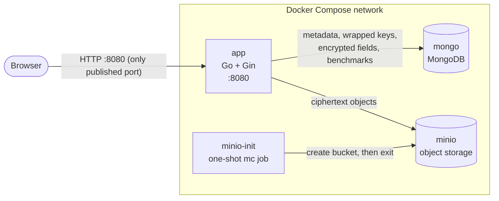
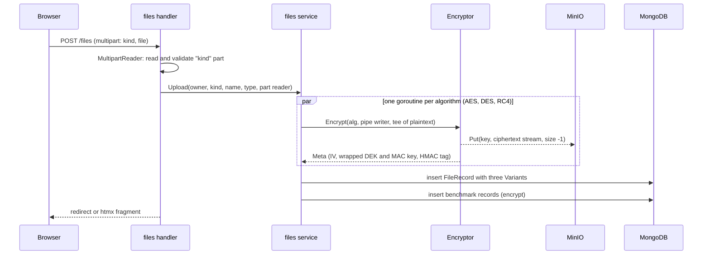
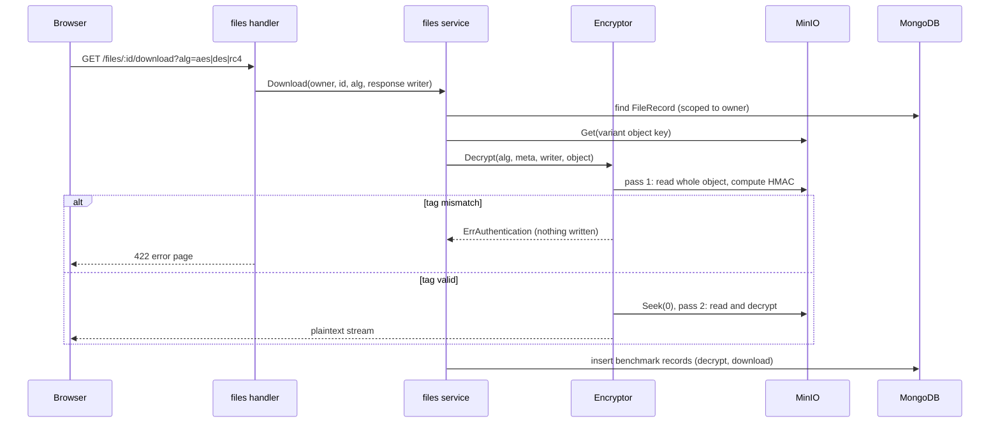

# Architecture

## Services

| Service | Role | Reachable from host |
|---|---|---|
| `app` | Web UI, authentication, encryption, streaming | Yes, `APP_PORT` |
| `mongo` | Users, profiles, file metadata, benchmark records, sessions | No (only via the override file on `127.0.0.1`) |
| `minio` | Encrypted file variants, one object per algorithm | No (only via the override file on `127.0.0.1`) |
| `minio-init` | Creates the bucket, then exits 0 | n/a |

`app` starts only after `mongo` and `minio` are healthy and `minio-init` has completed successfully.

## Keys

| Key | Scope | Where it lives |
|---|---|---|
| Master key (KEK) | Whole deployment | `MASTER_KEY` environment variable only |
| Data key (DEK) | One algorithm × one file or field | Wrapped with the KEK in `Meta.WrappedDEK` |
| MAC key | One algorithm × one file or field | Wrapped with the KEK in `Meta.WrappedMACKey` |
| IV | One algorithm × one file or field | Plaintext in `Meta.IV` (16 B AES, 8 B DES, none for RC4) |
| NIK blind-index key | Whole deployment | Derived from the KEK with HKDF, never stored |

## Upload flow

1. The handler reads the request with `c.Request.MultipartReader()`. The `kind` part comes first and is checked against the allowlist before any file bytes are read.
2. The service reads the file part exactly once. An `io.MultiWriter` fans it out to three `io.Pipe`s, one per algorithm.
3. Each goroutine encrypts its stream. AES and DES use CTR; RC4 is a native stream cipher. The ciphertext is MACed as it is produced (the MAC also covers a header with the algorithm, IV and wrapped keys; see `docs/decisions.md` D8) and piped straight into `ObjectStore.Put` with unknown size, so MinIO receives it in bounded 16 MiB parts.
4. When all three finish, one `FileRecord` holding all three `Variant`s (object key and `Meta`) is inserted. If any variant fails, the objects already written are deleted and no metadata is stored.
5. Each encryption is wrapped in `benchmark.Measure`, which records crypto-only time (via `crypto.Clock`) and total time.

Plaintext exists only in memory buffers in transit. It is never written to disk or stored whole in memory.

## Download flow

1. The record is looked up by ID **and** owner, so another user's file reads as "not found".
2. `Decrypt` first reads the whole stored object and checks the HMAC tag with `hmac.Equal`. Until that check passes, nothing is written to the response, so tampering can still be reported with an error status.
3. It then seeks the object back to the start (MinIO objects support `Seek`) and streams the plaintext into the response, recomputing the MAC as it goes so that an object replaced between the two passes is still reported as `ErrAuthentication`.
4. Both passes are timed. The repeated-download script in `scripts/bench/` produces the data for the report.
